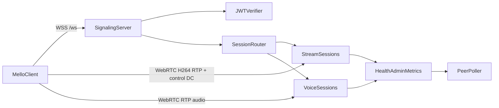

# SFU Server Specification

> **Component:** SFU Server (Go)
>
> **Version:** 0.2
>
> **Status:** Active (implemented)
>
> **Related docs:** [README.md](./README.md), [SELF-HOSTING.md](./SELF-HOSTING.md), [ADMIN-API.md](./ADMIN-API.md)

---

## 1. Purpose

This document defines the SFU system contract for Mello:

- what the SFU does and does not do,
- why it is designed this way,
- what clients and backend services can rely on,
- what operators should expect in production behavior.

This is an architecture and behavior spec, not an implementation notebook.
Detailed deployment commands and code walkthroughs live in companion docs.

### 1.1 Scope

In scope:

- signaling contract over WebSocket,
- session model (stream and voice),
- media forwarding behavior,
- security and auth model,
- observability and failure semantics,
- capacity and error contracts.

Out of scope:

- deployment (see `SELF-HOSTING.md`),
- client UI behavior and codec tuning details outside SFU contracts.

---

## 2. Why This SFU Exists

Mello uses an SFU to remove mesh P2P fan-out limits while preserving low latency and operational simplicity.

### 2.1 Design Goals

- Keep sender upload roughly constant as audience grows.
- Preserve interactive latency over perfect delivery.
- Keep the server as a forwarder, not a transcoder/mixer.
- Keep session state in memory for fast hot paths and simple failure handling.
- Maintain explicit contracts between signaling, media, and backend routing.

### 2.2 Key Design Decisions

| Decision | Why |
|---|---|
| Stream video relay over H.264 RTP tracks | Hop-local NACK repair and standard RTCP feedback without transcoding or RTP renumbering |
| Stream control over reliable DataChannel only | Cursor, ping/pong, reliable metadata; no stream-video DataChannel |
| Voice relay over RTP tracks (Opus) | Better multi-party voice topology, explicit per-sender track semantics, and robust renegotiation control |
| In-memory session store with drain timeout | Simple, fast runtime with predictable reconnect semantics after failures/restarts |
| ICE-lite when public IP is configured | Reduces server-side ICE complexity and CPU while clients perform full ICE |
| Shared DTLS certificate per process | Avoids per-peer key generation overhead |

### 2.3 Non-Goals (Current Version)

- Server-side transcoding.
- Server-side audio mixing.
- Server recording pipeline.
- Simulcast/SVC adaptation layers.
- Durable session persistence across process restarts.
- macOS game/system audio on stream sessions (Windows only today).

### 2.4 Media Stack

| Module | Version | Before 2026-10-08 |
|---|---|---|
| `github.com/pion/webrtc/v4` | v4.2.23 | v4.2.9 |
| `github.com/pion/interceptor` | v0.1.49 | v0.1.44 |
| `github.com/pion/ice/v4` | v4.4.7 | v4.2.1 |
| `github.com/pion/dtls/v3` | v3.1.10 | v3.1.2 |
| `github.com/pion/srtp/v3` | v3.1.3 | v3.0.10 |
| `github.com/pion/rtp` | v1.10.5 | v1.10.1 |
| `github.com/pion/rtcp` | v1.2.19 | v1.2.16 |
| `github.com/pion/sctp` | v1.12.0 | v1.9.2 |
| `github.com/pion/sdp/v3` | v3.0.20 | v3.0.18 |
| `github.com/pion/datachannel` | v1.6.3 | v1.6.0 |
| `github.com/pion/mdns/v2` | v2.2.2 | v2.1.0 |
| `github.com/pion/stun`, `transport`, `turn` | v4.0.1, v5.1.1, v5.1.2 | v3.1.1, v4.0.1, v4.1.4 |

- The Pion stats interceptor (v0.1.44 to v0.1.49) starts a recorder with
  `WaitGroup.Add` when a stream binds and waits on that WaitGroup in `Close`,
  without ordering the two. Pion closes a PeerConnection on its own after a
  DTLS failure, and a concurrent `SetRemoteDescription` that starts senders
  then binds during `Close`. No Pion release orders them. The SFU registers
  the stats interceptor behind a close guard (`configureStatsInterceptor`):
  a stream bind completes before `Close` or is not passed to the stats
  interceptor. `PeerConnection.GetStats` keeps working.

---

## 3. System Context



### 3.1 Network Surfaces

- `GET /ws` on `SFU_ADDR` (default `:8443`): signaling.
- `GET /health` on `SFU_ADMIN_ADDR` (default `:8080`): public health.
- `GET /stats` on `SFU_ADMIN_ADDR`: a compact summary for a status dashboard (bearer-token auth, see §8.4).
- `/admin/api/*` on `SFU_ADMIN_ADDR`: the JSON admin API (§8.2). The SFU
  serves no web UI; `/admin` answers 404 with one line that says so.
- `/debug/pprof/*` on `SFU_ADMIN_ADDR`: profiling endpoints (admin-auth wrapped).
- WebRTC media plane:
  - stream video over H.264 RTP tracks,
  - stream control over reliable DataChannel only,
  - voice over RTP audio tracks.

When `SFU_PUBLIC_IP` is set, ICE-lite + NAT1To1 + UDP mux on `0.0.0.0:10000` are enabled for media connectivity.

Passive ICE-TCP (RFC 6544), for clients on networks that block UDP:

- With `SFU_PUBLIC_IP` set, the SFU also listens for ICE-TCP on
  `0.0.0.0:<SFU_ICE_TCP_PORT>` (TCP, default `10000`; `0` disables it). One
  listener serves every PeerConnection.
- Each answer then carries, next to the UDP host candidate, a TCP host
  candidate on `SFU_PUBLIC_IP:SFU_ICE_TCP_PORT` with `tcptype passive`. The
  SFU gathers only IPv4 candidates (`udp4`, `tcp4`).
- The UDP candidate has the higher priority (Pion: 2130706431 against
  1671430143). A client that can reach the UDP candidate selects a UDP pair;
  TCP carries media only when UDP fails.
- **Client requirement:** to reach the SFU from a network that blocks UDP,
  the client must enable active ICE-TCP in its ICE agent (libdatachannel:
  `rtc::Configuration::enableIceTcp = true`) and must keep the `tcp`
  candidates of the SFU answer. The client connects to the passive candidate
  as an active TCP client with RFC 4571 framing. TURN over TCP or TLS is not
  needed for the SFU path.
- A full TCP send buffer (4 MiB per connection) drops packets: a slow TCP
  receiver does not block forwarding to other receivers.

### 3.2 Session State Model

The SFU keeps all session state in process memory.

- `StreamSession`: one `host`, many `viewers`.
- `VoiceSession`: many `members`.
- `SessionStore`: in-memory map plus drain garbage collection.

Session states:


- `Active -> Draining`: host disconnects (stream: the session hold, §4.1) or
  all members leave (voice).
- `Draining -> Closed`: after `DrainTimeout` (30s) in background cleanup.
- `Draining -> Active`: possible on rejoin before timeout for voice or a
  replacement stream host.
- A voice session goes to `Closed` under its own lock. A voice join that
  looked the session up before it closed does not reactivate it: the join
  goes to a new session under the same key.

### 3.3 Multi-Instance Behavior

- Optional sibling discovery via `SFU_PEERS` (`host:port` list).
- Peer poller queries `http://<peer>/health` every 30s.
- Aggregate status is exposed through admin API for cross-instance visibility.
- A peer is marked unreachable after repeated misses.

---

## 4. Session Semantics

### 4.1 Stream Session

- Keyed by `session_id`.
- Exactly one active host at a time.
- Host reconnect with same user ID evicts prior host connection.
- Viewer reconnect with same user ID evicts prior viewer connection.
- Every member, host and viewers, receives `member_joined` for each member
  that joins after it, with `role` `host` or `viewer`. A viewer that joins
  before the host receives `member_joined` with `role: host` when the host
  joins. A reconnect that evicts the old connection is announced again with
  `member_joined` to the other members.
- When a viewer leaves, the host and the other viewers receive `member_left`
  with `role: viewer` and `reason: disconnect`. A reconnect sends no
  `member_left` for the connection it evicts.
- `joined.members` lists the other members at the moment of the join. A
  reconnect does not list the connection it evicts.
- A join takes its `joined.members` snapshot, chooses the members that get
  `member_joined` (the members in that snapshot) and adds the peer as one
  step under the session lock. Of two peers that join at the same time, the
  second lists the first in `joined.members` and the first receives
  `member_joined` for the second: every member learns of every other member
  in exactly one of `joined.members` and `member_joined`. A `member_joined`
  can reach a member before its own `joined`.
- **Clean host leave.** A host that ends the stream on purpose (a `leave`
  message, or a WebSocket close with code 1000) ends it for the viewers at
  once: they receive `session_ended` (not `member_left`), and the session
  begins draining with no hold. The drain later sends no second
  `session_ended`. The Mello client sends `leave` when the host stops the
  stream.
- **Session hold.** If the host disconnects without a clean leave (the
  socket drops, ICE fails, the slow-peer check removes it), the session
  begins draining and the viewers receive `host_reconnecting` (not
  `member_left`) with
  `hold_ms` 30000 (`DrainTimeout`). The viewers keep their PeerConnections
  and their RTP legs. A host that joins during the hold (the same user, or
  a replacement host) re-wires the ingress: the viewers receive
  `member_joined` with `role: host`, then `host_reconnected`, and the new
  host's media on the legs they have. When the hold ends without a host,
  the drain closes the session and the viewers receive `session_ended`
  (`reason: host_disconnected`). The drain loop runs every 5 s, so the
  hold is 30 to 35 s.
- Across a host change the SFU continues the sequence numbers of each
  viewer leg after the last number it forwarded. A new host starts at a
  random number; one up to 32768 below the old number is old to SRTP
  replay protection on the viewer, which drops the new packets.
- The host events to a viewer (`host_reconnecting`, `member_joined` with
  `role: host`, `host_reconnected`, `session_ended`) are queued under the
  session lock, in the order of the
  session changes, and each viewer's queue is sent on its own goroutine. A
  viewer whose socket is slow delays only its own events: a host disconnect
  or a host join does not wait for it.
- A host rejoin during the drain grace period reactivates the same session
  (the hold above).
- Final drain cleanup cancels viewer RTP/RTCP legs and releases their senders.

### 4.2 Voice Session

- Keyed as `voice:<crew_id>:<channel_id>`.
- All peers are role `member`.
- Join/leave events are broadcast as `member_joined` / `member_left`.
- A join takes its `joined.members` snapshot, sends `member_joined` to the
  members in that snapshot and adds the peer as one step under the session
  lock. Two members that join at the same time each learn about the other
  in exactly one of `joined.members` and `member_joined`. A `member_joined`
  can reach a member before its own `joined`.
- Voice forwarding uses RTP read/forward loops, not media DataChannel forwarding.
- A member reaches each receiver on a receive slot (§6.2). A join or a leave
  within the slots changes no m-line and sends no `offer`.
- Reconnect path removes stale outgoing tracks to prevent one-way audio. It
  renegotiates only a receiver that had the old connection on its own m-line
  (past the slots).
- An inbound audio track is identified by the `TrackRemote` instance, never by
  its SSRC. A re-fired `OnTrack` carrying a previously-seen SSRC is a new track
  and always replaces the current reader.

### 4.3 Admission Control

Session creation and membership are bounded by config:

- `SFU_MAX_SESSIONS` (default `500`): total stream+voice sessions.
- `SFU_MAX_PEERS_PER_SESSION` (default `100`): applies to both stream and voice.

Rejections use explicit signaling errors:

- `SERVER_AT_CAPACITY`
- `SESSION_FULL`
- `SESSION_CLOSED` (drain cleanup won a concurrent join; client may retry).
  A stream or voice join that finds the session closed after its lookup
  joins a new session under the same id once, before it reports this
  error.
- `HOST_ALREADY_CONNECTED` (stream host conflict)

---

## 5. Signaling Contract (WebSocket)

### 5.1 Connection and Auth

Primary mode:

- Client connects to `/ws?token=<jwt>`.
- JWT verification uses RS256 if `SFU_JWT_PUB_KEY` is configured.

Test/dev mode:

- `/ws?test_password=<SFU_TEST_PASSWORD>&test_type=<stream|voice>[&test_crew_id=<id>]`
- Intended for soak/testing tools, canaries and local diagnostics.
- Off unless `SFU_TEST_PASSWORD` is set. Its own secret, not the admin
  password: it travels in a query string, which proxies and access logs keep.

### 5.2 Message Envelope

All signaling messages use:

```json
{
  "type": "message_name",
  "seq": 0,
  "data": {}
}
```

`seq` is accepted on input but not required for behavior. Core routing is by `type`.

One inbound message is at most 512 KiB (the largest real one is a
`logs_bundle` chunk). A bigger one closes the socket with code 1009 (message
too big). A client-supplied string that goes into a log entry, such as an
unknown `type`, is cut to 64 bytes.

### 5.3 Client -> Server Messages

| Type | Required data | Notes |
|---|---|---|
| `join_stream` | `session_id`, `role` (`host`/`viewer`) | Validates token type/role/session claims |
| `join_voice` | `crew_id`, `channel_id` | Token must be voice type; `crew_id` and `channel_id` must match the token's `crew_id` and `ch_id` |
| `offer` | `sdp` | Initial negotiation and client-initiated renegotiation/ICE restart |
| `answer` | `sdp` | Response to server-initiated `offer` |
| `ice_candidate` | `candidate`, `sdp_mid`, `sdp_mline_index` | Trickle ICE |
| `client_stats` | free-form object | Voice endpoint telemetry; logged as `client_stats`. The SFU does not read `is_speaking` from it: speaking is in-band (below) |
| `stream_client_stats` | free-form object | Stream host/viewer telemetry; logged as `stream_client_stats` with `role` |
| `leave` | none | Server sends `left` then closes WS |
| `logs_bundle` | `request_id`, `seq`, `last`, `data` (base64), or `request_id`, `error` | The client's answer to `request_logs`: its gzipped app log in chunks of at most `chunk_bytes`, in order from `seq` 0 (§8.8) |

A socket joins one session. A `join_stream` or `join_voice` on a socket that
is already in a session gets `INVALID_REQUEST`; a join that failed can be
retried. To switch sessions, a client opens a new socket.

Both stats messages are rate-limited to one per 5 s per peer and capped at 2048
bytes; oversized stream payloads are dropped and counted as
`stream_client_stats_oversized`. They are advisory telemetry: the server never
makes routing or admission decisions from them.

Stream sessions are the ones that cannot be debugged from the user's machine, so
`stream_client_stats` is the only view the operator gets into a remote host's
capture, encoder and pacing behaviour, and a remote viewer's decode cadence and
freeze time.

**Voice control channel, client -> server.** The voice client opens a reliable
DataChannel with label `control`. Messages are JSON text, under 256 bytes.
It opens no other DataChannel. Audio goes on the RTP track. A client must
not wait for any channel other than `control` before it is ready.

- The SFU closes a channel with any other label (log
  `datachannel_rejected`), voice and stream.
- One exception, for clients before the stream-5 change: they open an
  unreliable `audio` channel and wait until it is open. The SFU keeps that
  channel open and forwards nothing on it (log `datachannel_ignored`, once
  per peer). With `SFU_REJECT_LEGACY_AUDIO_DC=true` the SFU closes it too;
  turn that on when no such client is left.

| Message | Notes |
|---|---|
| `{"type":"ping","ts":<ms>}` | The SFU echoes it as `pong` (text) on the channel it came on: voice, and stream host and viewer legs. RTT and liveness. A stream ping is answered, not forwarded to the host (before, a viewer's ping went to the host and a host's was ignored, so stream `rtt_ms` was 0; `TestStreamControlChannelAnswersPing`) |
| `{"type":"speaking","on":<bool>}` | Sent when the client's VAD opens or closes, at most one change per 100 ms. The SFU records it per peer for the `rtp_blackout` check and fans a change out (§5.4) |

### 5.4 Server -> Client Messages

| Type | Data | Purpose |
|---|---|---|
| `welcome` | `server_id`, `region` | First server message on successful WS connect |
| `joined` | `session_type`, `session_id`, `members[]` | Session join acknowledgment |
| `member_joined` | `user_id`, `role` | Membership event, to every other member of the session. Stream: `role` is `host` or `viewer` (§4.1); voice: `member` |
| `member_left` | `user_id`, `reason`; stream also `role` | Membership event, to every remaining member. Stream: only for a viewer, `role: viewer` |
| `host_reconnecting` | `user_id`, `reason`, `hold_ms` | Stream host disconnected without a clean leave; to every viewer, in place of `member_left` for the host. The session waits `hold_ms` for a host (§4.1); the viewer keeps its PeerConnection |
| `host_reconnected` | `user_id`, `role` (`host`) | A host joined during the hold; after `member_joined` for that host. The host's media comes on the viewer's existing legs |
| `session_ended` | `reason` | The host left cleanly, or the hold ended without a host (the drain closed the session); to every viewer |
| `answer` | `sdp` | Answer to client `offer` |
| `offer` | `sdp` | Server-initiated renegotiation or ICE restart |
| `ice_candidate` | candidate fields | Trickle ICE |
| `left` | `reason` | Ack for client-initiated leave |
| `error` | `code`, `message` | Contract and runtime errors |
| `request_logs` | `request_id`, `since_hours`, `max_bytes`, `chunk_bytes` | An admin asks the client for its app log of the last `since_hours` (§8.8) |

**Voice control channel, server -> client.** JSON text on the `control`
DataChannel. A stream `control` channel gets `pong` too.

| Message | When | Purpose |
|---|---|---|
| `{"type":"pong","ts":<ms>}` | On each `ping` | RTT |
| `{"type":"slot","mid":"<mid>","user":"<user_id>"}` | A receive slot or an own m-line of this receiver starts to carry `user_id` | The client routes RTP on `mid` to `user_id` |
| `{"type":"slot","mid":"<mid>","user":null}` | The slot or own m-line is released | The client drops RTP on `mid` and releases the old owner's receive state |
| `{"type":"speaking","user":"<user_id>","on":<bool>}` | Another member's in-band speaking state changes | Speaking ring in one hop, not through the backend |

- A `slot` message goes only to the receiver that owns the slot. Slots are per
  receiver PeerConnection.
- When the control channel opens, the SFU sends the whole map: one `slot`
  message for each bound slot (`user` or `null`) and for each own m-line with a
  known mid. Then one `speaking` message with `on:true` for each member that
  speaks now. Messages sent before the channel opened are dropped.
- The SFU sends the slot changes of one receiver in order. It sends an assign
  (`user` set) before it forwards the new owner's first packet on the slot,
  and a release (`user:null`) after the slot stops carrying the old owner.
  RTP and the control channel are separate transports: the first RTP packets
  of a new owner can still arrive before its `slot` message. In the 50-member
  soak (10 runs, SFU and 50 clients on one loaded host) that is about 0.009 %
  of slot packets, at most 116 ms before the message. A client that keeps RTP
  on an unknown mid for 200 ms loses none of them.
- An own m-line (past the slots) is announced after the renegotiation `offer`
  that creates it, when its mid is known.
- The SFU sends a `speaking` message only on a change. It does not send
  `on:false` for a member that leaves; `member_left` covers it.

### 5.5 Negotiation Behavior

- Initial flow is offer/answer plus trickle ICE.
- Voice receive slots: the client's initial offer carries its sendrecv mic
  m-line and `N` recvonly audio m-lines, `N = 16` (`MELLO_VOICE_RECV_SLOTS` in
  libmello, `voiceRecvSlots` in the SFU). The SFU binds a sender with a silent
  placeholder track to each recvonly m-line, up to 16, before it creates the
  answer. A client that offers fewer slots gets the rest as own m-lines.
- A voice join or leave within the slots changes senders with
  `RTPSender.ReplaceTrack`. It sends no `offer` and no `answer`.
- Server can initiate renegotiation (`offer`) for voice track topology changes:
  only for a sender past the receiver's slots (own m-line added or stopped),
  and for ICE restart.
- Client responds with `answer`.
- At most one server `offer` waits for its `answer` per peer. A
  renegotiation that starts while an offer waits is queued (log
  `renegotiate_queued`): the SFU does not call `CreateOffer`, because Pion
  marks new senders negotiated in `CreateOffer`, and the pending answer then
  starts them on SSRCs that no m-line of the client declares. The queued
  renegotiation runs when the answer applies, or when the protection window
  below times out (log `renegotiate_retry`, `reason` `answer_applied` or
  `answer_timeout`). One retry offer carries every change made while the
  first offer waited.
- An ICE restart while a server offer waits for its answer fails without an
  offer, and the peer goes through the normal ICE failure removal.
- On ICE failure, server may send ICE-restart offer before removing peer.
- Answer is sent before local description is finalized to preserve expected candidate ordering.
- Stream viewers offer one recvonly H.264 video m-line. The SFU attaches its
  outgoing track after applying the offer and starts relay/RTCP loops only
  after the answer and local description are created successfully.
- A failed answer discards that PeerConnection and its prepared stream sender;
  a subsequent client offer negotiates on a fresh PeerConnection.
- PeerConnection callbacks are generation-bound so delayed callbacks from a
  replaced connection cannot signal or remove the current peer.
- Renegotiation protection window:
  - starts on server-initiated renegotiation/ICE-restart **and** client-initiated offer paths,
  - opens **before** any transceiver cleanup, so track churn the SFU itself
    causes is charged against the tolerant budget rather than the teardown limit,
  - is cleared only after the SDP answer is successfully applied,
  - is released again if the offer cannot be created or applied,
  - auto-clears on timeout (~12s) to avoid a stuck "renegotiating" state.
- While that window is active, inbound voice-track read loops tolerate transient EOF/read errors longer so track swaps don't trigger false teardown.

---

## 6. Media Plane Contract

### 6.1 Stream Media (H.264 RTP Relay)

- The stream host publishes H.264 media (PT 96). The SFU wires host ingress
  on the H.264 track. The SFU registers H.264 as `profile-level-id=4d0033`
  (Main, level 5.1, the level of mello's encoders since streaming-quality
  stage 4; 4d002a before). Pion matches H.264 on the profile bytes and
  answers with the offer's parameters, so a client at either level
  negotiates (`TestSFUAnswersLevel42AndLevel51HostOffers`).
- **FEC is off.** The SFU does not register ULPFEC, so its answer to a host
  offer has no `ulpfec` payload type and the host sends no parity. A video
  track with another codec is rejected (`stream_video_track_rejected`).
  mello streaming-quality stage 4 removed the send-side FEC (NACK, RTX and
  goog_cc repair and adapt instead). Before, the viewer FEC track was on a
  transceiver that the viewer did not offer: it was not in the answer, and
  Pion wrote its packets to no binding.
- **Host RTX.** The host and voice API (`newSFUAPI`) registers RFC 4588 RTX
  at PT 97 with `apt=96`. A host that offers RTX (libmello since stage 4:
  `a=rtpmap:97 rtx/90000`, `a=ssrc-group:FID`) gets it in the answer and
  sends its NACK repairs and its goog_cc padding on its RTX SSRC. Pion
  unwraps a repair into the original packet (sequence number, payload type
  and SSRC of the media) on the host track, so the relay forwards it like a
  late packet (the duplicate window below lets it through once). Pion drops
  padding-only RTX packets after the interceptors, so they count for TWCC
  and reach no viewer. Before, the SFU registered no RTX: a repair came on
  an SSRC that no m-line declared and Pion dropped it. The viewer API
  (`newSFUViewerAPI`) does not register RTX: the SFU repairs viewers from
  its own NACK cache on the viewer SSRC (below). The relay counts the
  repairs: `rtx_recovered_packets` (forwarded: the original was lost) and
  `rtx_duplicate_packets` (dropped: the original had arrived) in
  `stream_relay_stats.rtp_totals`. Tests:
  `TestHostRTXRepairReachesTheHostTrack`, `TestViewerAnswerHasNoRTX`,
  `TestIngressCountsRTXRepairs`.
- **NACKs to the host.** The SFU's own NACK generator (`nack_generator.go`,
  every API; Pion's NACK responder stays) asks the host for a missing packet
  at its next 20 ms tick, and asks again only after 1.5 round trips (the
  time from the first NACK of a packet to its RTX repair, averaged; 100 ms
  before the first measurement, at least 50 ms), at most 10 times. It reads
  the original sequence number of each RTX repair, so a repaired packet is
  never asked for again. Pion's generator asked every 100 ms whatever the
  round trip and never saw a repair (Pion hands RTX repairs to the track
  reader outside the media stream's interceptors), so it asked for each
  repaired packet until it left its 512-packet log: under the
  streaming-quality gate's congested cap, 607 duplicate repairs for 94
  recovered packets. Relay stats: `host_nack_first` (packets asked for),
  `host_nack_retries`, `host_nack_repaired`, `host_nack_late_originals`
  (asked for, then came late on the media stream), `host_nack_gave_up`,
  `host_nack_rtt_ms`. Tests: `TestNACKGeneratorWaitsForTheRoundTripAndSeesRTXRepairs`,
  `TestSFUAsksTheHostOnceForARepairedPacket` (10 more NACKs after the
  repair with Pion's generator).
- Each viewer has one negotiated outgoing H.264 RTP track on the viewer's
  recvonly video m-line. The SFU adds no m-line that the viewer did not
  offer. The host does not receive an outgoing stream-video track.
- Host ingress preserves source sequence number, timestamp, and marker for
  the first host ingress of a session. After a host change the sequence
  number continues the viewer leg's numbers (§4.1, session hold).
  `TrackLocalStaticRTP.WriteRTP` rewrites each packet to the viewer leg's
  negotiated SSRC and PT.
- A bounded wrap-safe duplicate window suppresses repeats while allowing a
  late repaired packet to forward once.
- Downstream NACK repair is hop-local through Pion interceptors; viewer NACKs
  are not forwarded to the host. Pion's NACK responder keeps the last 1024
  packets of each viewer leg. It binds only when the viewer's video m-line
  offers `a=rtcp-fb:96 nack`, and it answers a NACK only while the SFU reads
  the viewer's RTCP through the `RTPSender`. The interceptor chain parses
  each RTCP packet in that read and returns a parse error for a packet that
  does not parse. The read loop counts that packet
  (`rtp_viewer_rtcp_invalid` in the stream relay stats, log
  `stream_viewer_rtcp_invalid`) and continues. It ends only when the stream
  closes.
- Viewer PLI/FIR requests are coalesced per viewer to at most one upstream
  PLI per 200ms per viewer, so one viewer's keyframe request cannot starve
  another's.
- **Upstream REMB: a sanity ceiling, never the minimum.** The host's rate
  follows its own leg: its goog_cc on the transport-cc feedback the SFU
  sends it (streaming-quality stage 4). The SFU adapts each viewer on that
  viewer's own leg (§6.3: keyframes only, then `PEER_SLOW`). The REMB to
  the host carries only a ceiling, the highest of the viewers'
  contributions (fresh: 2 s):
  - a viewer with a fresh gcc estimate (below) contributes no limit
    (25 Mbps, the estimator's maximum);
  - a viewer without transport-cc in its description contributes its
    fresh REMB, its own estimate (at least 500 kbps while it is floored,
    §6.3). The REMB of a transport-cc viewer is ignored: libmello sends
    its receive target (4 Mbps by default) as REMB at connect;
  - a viewer that went slow (§6.3) is **constrained**: it contributes its
    estimate, at least 500 kbps, until its estimate reaches the host rate
    it could not carry (the host ingress rate when it went slow) while it
    is not slow, or until it has had no estimate for 10 s.

  So the ceiling lowers the host only when every viewer is slow or
  constrained, to the rate the best of them can take; one viewer that
  carries the stream lifts it. Why not the minimum: the per-viewer gcc
  estimate is not a measure of what a leg carries. On the deployed SFU it
  fell to 0.3 Mbps on legs that carried the 7.5 Mbps stream (no loss, and
  2 to 5 % loss), and after the host's resolution rung it fell from 10 to
  18 Mbps to 0.10 Mbps on an unimpaired leg. Forwarded as the minimum (with
  the sender SSRC fix below) it took the host on the gate's hardware mobile
  profile from 7.9 Mbps and 59 fps to 1.56 Mbps and 28 fps, and one slow
  viewer governed the rate of every viewer. Why a ceiling at all: when no
  viewer can take the stream, a lower rate that the best of them can carry
  is better than keyframes only for all. The SFU sends the REMB at a
  bounded rate (one per 200 ms), on a viewer REMB and on the ~1 s stats
  tick, so stale or departed viewers cannot pin the host. The log line
  `stream_host_remb_tick` has the value, `constrained` (viewers that hold
  it down) and `ingress_bps`.
- **REMB sender SSRC.** The REMB's sender SSRC is the host's video SSRC
  (its media source SSRC is 0, as RFC REMB says). libdatachannel, the
  host's stack, routes an incoming RTCP packet to a track by the sender and
  media source SSRCs of its header; with sender 0 the host's video track
  never got the REMB (no libmello host had ever applied it before this).
  Tests: `TestUpstreamREMBUnderOneImpairedViewerAmongHealthyOnes`,
  `TestUpstreamREMBAfterAViewerSizeChange`,
  `TestUpstreamREMBIgnoresTheReceiveTargetOfATransportCCViewer`,
  `TestStreamFeedbackTickRecomputesWithoutFreshREMB`.
- **TWCC:** the shared WebRTC API negotiates `transport-cc` and
  stamps transport-wide sequence numbers toward viewers. Pion generates TWCC
  feedback to the host on the host→SFU leg.
- **Per-viewer estimate, no SFU pacer.** Stream viewer PeerConnections are
  created by a second WebRTC API (`newSFUViewerAPI`) whose interceptor
  chain has Pion's `cc` interceptor with one `gcc.SendSideBWE` per
  PeerConnection (initial 10 Mbps, 300 kbps to 25 Mbps). It is the first
  interceptor of the chain, so it sees each packet after the transport-cc
  header extension interceptor numbered it, and it reads the viewer's
  transport-cc feedback. Its pacer is a no-op: the SFU forwards at once.
  The estimate counts only while transport-cc feedback reached it in the
  last 2 s: a viewer that sends none, or sends feedback that does not
  parse (libmello before stage 4: `rtp_viewer_rtcp_invalid`), has no gcc
  estimate (its REMB counts only without transport-cc in its description,
  above). Host and voice PeerConnections have no estimator.
- **Feedback the estimator can read.** The SFU corrects each transport-cc
  feedback packet before Pion's estimator reads it
  (`viewer_bwe_feedback.go`). Pion's feedback adapter (interceptor
  v0.1.49) takes every symbol of every status chunk as a packet, also the
  padding symbols of a last status vector chunk after the packet status
  count; they name the newest packets, in flight, so each one counted as
  lost. A libmello viewer ends a feedback with a vector chunk when a loss
  or a large delta breaks the last run, or when the feedback has fewer than
  7 packets: at a low rate (4 packets per 50 ms feedback, as after the
  host's 540p rung) Pion read 71 % loss on a leg with none and took the
  estimate to its 100 kbps loss floor in about 2 s; with 5 % real loss it
  read 7 to 11 % and the estimate fell by half in 3 s (the gate's mobile
  profile: 6.2 to 0.19 Mbps in 12 s). The SFU keeps only the packet status
  count entries. It also drops entries older than the last 240 packets
  sent: Pion's history keeps 250, and an entry it does not find counts as
  lost and its delta is not consumed, which shifts every later arrival
  time. The first kept delta carries the dropped ones. The tick log counts
  both per viewer (`padding`, `overrun` in `viewer_bwe`). Tests:
  `TestViewerEstimateHoldsWithLibmelloFeedback` (8 Mbps to 0.1 Mbps in 3 s
  without the correction), `TestSanitizeFeedbackDropsPaddingAndOldEntries`.
- Viewer egress queues are depth 64; RTCP reads use an 8 KiB buffer.
  Sustained per-viewer queue backlog (>5s) drops the backlog and sends an
  upstream PLI.
- **Late join.** The SFU caches the last complete IDR access unit of the host,
  up to 2048 packets and 2 MiB of payload. A bigger access unit is not cached,
  and a late viewer then waits for the IDR its PLI asks for.
  A viewer leg forwards nothing until the viewer's PeerConnection is
  `connected`: before DTLS, Pion's SRTP writer drops every packet. On
  `connected`, the writer sends the cached IDR as one burst outside the queue
  cap (log `stream_idr_replayed`), then the live packets. The cache snapshot
  and the start of live forwarding are one step under the session lock, so a
  packet is in the replay or in the queue, not in both. The live packets
  after an old IDR do not chain to it, so right after the replay the SFU
  sends one PLI to the host for that viewer. It counts as the viewer's PLI
  in the 200 ms coalescing: the viewer's own PLI for the same gap, about
  120 ms later, sends no second one. The fresh IDR arrives that much
  sooner.
- DataChannels on stream sessions:
  - `control` carries reliable viewer-to-host control (forwarded to the
    host; the host's own messages are not forwarded) and ping/pong (the
    SFU answers each `ping` on the leg it came on, §5.3),
  - there is no stream-video `media` DataChannel: the SFU closes a channel
    with any other label (`media` or another; log `datachannel_rejected`),
    except a legacy `audio` channel (§5.3).

**Stream game audio:**

- Host publishes Opus (PT 111) on a sendonly audio m-line alongside H.264.
- Each viewer offers recvonly audio; SFU attaches one outgoing Opus track per
  viewer (reuses offered transceiver, same pattern as video).
- Single host ingress loop (`WireAudioTrackFor` → `readHostAudioRTP`) fans out
  via `fanOutAudioRTP` (queue depth 32, non-blocking per viewer).
- No FEC/TWCC/GCC on the audio leg in v1. The Opus payload carries its own
  in-band FEC (mello streaming-quality stage 7); the SFU does not read it.
- The SFU forwards each audio packet's RTP header extensions unchanged. mello's
  host puts the A/V sync extension on every game-audio packet (one-byte form,
  ID 5, URI `urn:mello:params:rtp-hdrext:av-sync-video-ts`, 4 bytes: the video
  RTP timestamp of the instant the audio was captured). The SFU does not
  negotiate the URI, so both clients use the fixed ID; the viewer maps its audio
  clock to the video clock with it (mello `12-STREAMING.md` §9.4). The sequence
  rewrite (`streamSeqRewriter`) changes the sequence number only. Test:
  `TestStreamAudioForwardsTheAvSyncExtension`.
- A new host video track replaces only the H.264 ingress, so host audio
  ingress keeps flowing whatever the track order (`stream_ingress_cancelled` logs
  each ingress cancel with its kind).

### 6.2 Voice Media (RTP Relay)

- Voice ingress uses remote RTP audio tracks (`OnTrack`). The SFU reads each
  member's inbound track once.
- For each receiving peer, SFU creates per-sender outgoing `TrackLocalStaticRTP`.
  `SendRTP` finds the receiver's track by the sender's user id.
- RTP packets are forwarded to all other members (not looped to sender).
- SSRC is rewritten to negotiated per-receiver track SSRC. For a receive slot
  that is the slot's SSRC.

**Receive slots.**

- Each recvonly audio m-line of the client's initial offer is one slot with a
  fixed mid, up to 16 (`voiceRecvSlots`). The SFU gives its transceiver a
  sender (`API.NewRTPSender` + `RTPTransceiver.SetSender`) with a placeholder
  `TrackLocalStaticRTP` that is never written. The answer declares the slot's
  SSRC. `PeerConnection.AddTrack` is not used: it binds the client's sendrecv
  mic m-line first.
- Assign: the slot's sender swaps to a forwarding track for the member with
  `ReplaceTrack`. Release: it swaps back to the placeholder. A write to a
  released forwarding track reaches nobody.
- Free slot choice: a slot never used first, in offer order, then the slot
  released longest ago.
- The SSRC stays the same for the life of the slot. The SFU rewrites the RTP
  sequence number per slot, so it stays continuous across owners. Without the
  rewrite, SRTP replay protection on the receiver drops a new owner's packets
  whose sequence numbers the old owner already used.
- The RTP timestamp is not rewritten. The client releases the old owner's
  receive state on the `slot` message, so a new owner starts a new stream.
- Past the slots, the receiver gets an own sendonly m-line per extra sender
  (`AddTransceiverFromTrack`) and a renegotiation `offer`, as before slots.
- Pion spike (v4.2.9, 2026-10-07; passes unchanged on v4.2.23), kept as
  `TestVoiceSlotsSwapOwnersWithoutRenegotiation`: a transceiver created from
  the client's recvonly m-line holds a placeholder sender at answer time.
  `ReplaceTrack` after the connection is up raises no `negotiationneeded`,
  keeps the signaling state `stable`, and keeps the SSRC.
- DataChannel use in voice is limited to control channel handling. The SFU
  closes any other channel, except a legacy `audio` channel (§5.3).
- Clients **must** declare `a=ssrc` on their voice audio m-line. Without it Pion
  cannot bind the mic to the negotiated m-line and instead routes it through its
  undeclared-SSRC handler, which synthesizes an extra `sendrecv` transceiver.
- Transceiver cleanup never stops the transceiver feeding the peer's currently
  wired inbound track, regardless of its direction. Only superseded duplicates
  are stopped, which is what keeps auto-created transceivers from accumulating.
- Transceiver cleanup never stops a receive slot, whatever track it carries.
- `rtp_blackout` (zero inbound RTP for 15 s with two or more members) warns only
  while a member's in-band speaking flag is on.

### 6.3 Backpressure and Slow-Peer Policy

- DataChannel send buffer guard: `2 MiB` per peer.
- If over limit, packets drop (non-blocking fan-out model).
- Stream RTP uses a bounded per-viewer queue. A full viewer queue drops only
  that viewer's packet and does not block healthy viewers.
- Sustained buffer overflow (`>5s`) triggers forced disconnect with `PEER_SLOW`.
- **Slow stream viewer: lower first, kick last.** A stream viewer is over
  budget while its RTP queue stays not empty for 1 s (its writer does not
  keep up), or while its fresh estimate (§6.1) has stayed under 500 kbps
  for 3 s of consecutive samples (the stats tick and each viewer REMB)
  **and** the viewer NACKed at least 20 % of the packets sent on its leg in
  those 3 s (at least 50 packets sent). A shorter dip, or a dip on a leg
  with less loss, changes nothing. The estimate is the gcc target while the
  viewer's transport-cc feedback is fresh (2 s), else its REMB: a viewer on
  keyframes only gets few packets, and a stale gcc target does not hold it
  slow. No fresh estimate is not a sample under the floor. The loss counts
  each sequence number of the leg once, and only for a packet that the leg
  sent: a NACK for a host-leg gap, or for a delta that a slow viewer's
  queue did not take, is no loss on the leg (relay stat
  `rtp_viewer_nacked_packets`, all viewer legs together). Why the loss
  condition: on the deployed SFU (streaming-quality stage 4 baseline) the
  gcc estimate of legs that carried the stream fell under the floor (25 to
  0.29 Mbps in 3 s with no loss; 6.2 to 0.19 Mbps in 12 s with 5 % loss),
  and the estimate alone put those viewers on keyframes only (7 s frozen in
  20 s). A leg that carries the stream loses at most about 10 % (the
  gate's bad profile); a link under about 80 % of the stream rate loses
  more. A viewer that sends no NACK is slow only by its queue. While it is
  over budget:
  - its estimate counts as at least 500 kbps in the upstream REMB, so one
    slow viewer cannot pull the shared encode under that floor (an estimate
    under the floor for 3 s on a leg without that loss counts as 500 kbps
    too, and that leg keeps all packets);
  - its queue takes only the packets of IDR access units (a packet with an
    IDR slice, SPS or PPS, and every packet with the same timestamp). The
    other packets count in `rtp_slow_viewer_dropped_packets`. When it goes
    over budget, its backlog is dropped once and the SFU sends one PLI for
    it (in its 200 ms PLI coalescing).
  It gets all packets again after 3 s within budget. A viewer that stays
  slow for 15 s gets `error` `PEER_SLOW` and is removed. The client treats
  `PEER_SLOW` as a reconnect.
- Sustained RTP write failures (`>=50` streak over slow-peer window) trigger `PEER_STALLED_RTP`.
- Slow/broken peers must not stall healthy peers.
- Each peer has one WebSocket writer. Every signaling message and the
  close frame of the peer go into one ordered queue, and one goroutine at a
  time writes it: the messages of a peer go out in the order they were
  queued. A sender that needs the write done (most sends) waits for its
  own write only; the host events of §4.1 are queued without a wait.
- Each signaling write has a 5 s deadline. A write that fails closes the
  WebSocket (log `signaling_write_failed`); the read loop then ends and the
  peer is cleaned up as on a disconnect.

### 6.4 Stream Snapshot Subsystem

- Snapshot capture is optional and activates only when `SFU_R2_ENDPOINT` is configured.
- **RTP video is the snapshot input.** Host ingress RTP is tapped non-blockingly before fan-out (`Pipeline.FeedRTP`).
- When enabled, snapshot intake is non-blocking (`chan *rtp.Packet`, capacity 4).
- Processing is asynchronous per session: RTP depacketize → AU assembly (120 ms deadline) → decode (OpenH264) → render (letterboxed `1280x720`) → JPEG encode (`quality=75`) → R2 upload.
- If `SFU_R2_ENDPOINT` is set, startup requires CGO+OpenH264 (`snapshot.DecoderAvailable()`); otherwise the server refuses to start.
- Upload keys follow: `snapshots/{crew_id}/{session_id}/{unix_ms}.jpg`.

---

## 7. Security Model

### 7.1 JWT Claims Used by SFU

| Claim | Purpose |
|---|---|
| `uid` | User identity |
| `username` | Display/log context |
| `sid` | Stream session binding (optional strict match) |
| `type` | `stream` / `voice` route enforcement |
| `role` | Role enforcement where applicable |
| `crew_id` | Voice crew authorization and session keying |
| `ch_id` | Voice channel binding: `join_voice` must name this channel |
| `region` | The region the backend signed the token for. A verified token whose claim names another region than `SFU_REGION` is refused at the WebSocket upgrade (`auth_failed`, HTTP 401): the session lives on the SFU of the claim's region, and a join here would open a second, empty session of the same id. No claim (an older backend) or no `SFU_REGION` passes. Dev-mode claims (`SFU_DEV_MODE` without a key) are not checked. `SFU_REGION` must be the region name the backend signs for this SFU (for example `eu-west`). |
| `exp` | Token expiry. Required |
| `iss` | Must be `mello-nakama`. Required |

A verified token must also carry the claims it binds: a `stream` token `sid`
and `role`, a `voice` token `crew_id` and `ch_id`. A token without them, or
of another `type`, is refused at the WebSocket upgrade (`auth_failed`, HTTP
401). The join handlers treat an empty claim as "any", which only test-mode
and dev-mode claims rely on.

`auth_failed` is sampled: at most 30 entries a minute are logged, and the
next logged entry carries `suppressed`, the number dropped since the last
one. Anyone can send a bad token, so the log cannot be used to fill the disk.

The SFU fails closed (`newVerifier` in `server.go`):

| `SFU_JWT_PUB_KEY` | `SFU_DEV_MODE` | `SFU_TEST_PASSWORD` | Client auth |
|---|---|---|---|
| set | any | any | RS256 tokens verified with the key; test-mode joins when the test password is set |
| empty | `true` | any | Any token accepted, its claims trusted without a signature check (log `dev_mode_auth_open`). Local development only |
| empty | off | set | Every token refused (`ErrNoKey`, HTTP 401); test-mode joins only (log `jwt_auth_off`) |
| empty | off | empty | The SFU does not start: it could authenticate no client |

### 7.2 Admin Surface Protection

Admin middleware behavior:

- If `SFU_ADMIN_PASSWORD` is empty: admin routes answer `503` (the admin API
  is off), or are open with `SFU_DEV_MODE=true`. The start log
  `admin_listening` names the state (`admin_api`).
- If set:
  - optional IP/CIDR allowlist via `SFU_ADMIN_IPS` (`403`),
  - the failure limit below (`429`),
  - HTTP Basic Auth password check (`401`).

This wrapper applies to `/admin/api/*` and `/debug/pprof/*`.

**Client address.** The allowlist and the failure limit use the connection's
peer address. `X-Forwarded-For` and `X-Real-IP` count only when the peer is
in `SFU_TRUSTED_PROXIES` (IPs or CIDRs): then the client is the last
`X-Forwarded-For` hop that is not a trusted proxy. Without the list the
headers are ignored, so a client cannot name an allowlisted address in them.

**Failure limit.** Wrong passwords (admin Basic Auth with a wrong password,
and test-mode joins, §5.1) count per client address. After 10 in one minute
the address gets `429` until its oldest failure is a minute old, for the
right password too. A right password clears the count. A request with no credentials does not count. A failed test-mode
join logs `test_auth_failed`.

### 7.3 Transport Security

- WebRTC media is DTLS-SRTP encrypted on each client↔SFU hop. The SFU terminates and re-encrypts media; this is not host-to-viewer end-to-end encryption.
- Signaling should run under TLS in production (direct certs or trusted reverse proxy).
- Both HTTP servers (signaling and admin) close a connection that has not
  finished its TLS handshake and request headers in 10 s, and an idle
  keep-alive connection after 2 minutes. They set no read or write timeout:
  a WebSocket outlives its upgrade, and a pprof profile takes 30 s.
- DTLS certificate lifecycle: one self-signed ECDSA P-256 certificate is shared
  by all PeerConnections. It is valid for 90 days and is rotated in place every
  14 days. New PeerConnections use the current certificate; existing ones keep
  the certificate they negotiated with. Peers are authenticated by the
  certificate fingerprint in the JWT-authenticated SDP, not by a CA chain.
- Do not use pion's `webrtc.GenerateCertificate` for the shared certificate. It
  has a fixed 30-day lifetime and no rotation. A process that ran longer than 30
  days rejected every PeerConnection (outage 2026-09-09: `/health` answered
  normally while every call failed, which is why §8.1 checks the certificate
  and §8.5 has a canary).

---

## 8. Observability Contract

### 8.1 Public Health Endpoint

`GET /health` returns status, identity, uptime, session counts, peer counts, bandwidth, snapshot totals, runtime stats, and WebRTC readiness.

`status` reports whether the SFU can establish media, not only whether the
process is alive:

| `status` | HTTP | Condition |
|---|---|---|
| `ok` | 200 | DTLS certificate valid for more than 7 days. |
| `degraded` | 200 | DTLS certificate valid, but for 7 days or less. The instance still serves; alert on it. |
| `unhealthy` | 503 | DTLS certificate expired or missing. Every new PeerConnection fails. |

The `webrtc` object:

- `dtls_cert_expires_in_seconds`: remaining validity of the shared certificate.
  Negative means expired.
- `connections_total`: PeerConnections created successfully.
- `failures_total`: PeerConnection setup failures. An expired certificate sends
  this up on every join while `connections_total` stays flat.

Current behavior details:

- `sessions.stream_active` and `sessions.voice_active` are populated.
- `sessions.*_draining` fields exist in schema but are currently not populated.
- `peers.total` is populated; role breakdown fields are currently reserved.
- `snapshots.total_uploaded` is a process-lifetime monotonic counter.

### 8.2 Admin API Surface

The SFU serves no web UI. An admin UI reads this JSON API with the admin
credentials, from a backend of its own: the API is not meant for browsers.
`/admin` and `/` answer 404 with one line that points at the API.
`ADMIN-API.md` is the short reference.

Endpoints, all behind the admin auth (§7.2):

- `GET /admin/api/overview` (live; with `range` from the store, §8.7),
- `GET /admin/api/sessions` (live; with `from`/`to` from the store),
- `GET /admin/api/session/{id}` (the live session),
- `GET /admin/api/session/{id}/timeline`, `GET /admin/api/session/{id}/events`
  (the store, §8.6),
- `GET /admin/api/logs` (the ring; with `from`/`to` the store),
- `GET /admin/api/peers` (this instance and its `SFU_PEERS`),
- `GET /admin/api/troubleshoot?window_minutes` (incidents, renegotiation
  funnel, capacity envelope, session trouble rows),
- `GET /admin/api/alerts` (§8.7),
- `GET /admin/api/minutes?days=N` (the store; the peer minutes per UTC day,
  below),
- `GET /admin/api/user/{id}/sessions`, `GET /admin/api/user/{id}/profile`,
  `POST /admin/api/user/{id}/request-logs`, `GET /admin/api/user/{id}/bundles`,
  `GET /admin/api/user/{id}/bundles/{name}`,
  `GET /admin/api/user/{id}/bundles/{name}/download` (§8.8),
- `/debug/pprof/*` (§8.3).

`/admin/api/sessions` and `/admin/api/logs` with `from` or `to` read the store
(§8.6); without them they answer as below.

Each row of `/admin/api/sessions` carries, next to the trouble counters:

- `host_user_id`, `host_username`: the stream host (empty for voice),
- `peers_connected`: peers whose PeerConnection is `connected`,
- `synthetic`: true when only test-mode peers ever joined (§8.4),
- `bytes_sent`, `bytes_recv`: the SFU's bytes to and from the session's peers.

Stream-session detail (`/admin/api/session/{id}`) additionally exposes:

- `snapshot_count` (per-session successful uploads, stream sessions only).
- In `stream_relay`, the host-leg ingress counters of §8.3
  (`rtp_ingress_expected`, `rtp_ingress_lost`, `rtp_ingress_loss_pct`), the
  RTX repairs (`rtp_rtx_recovered`, `rtp_rtx_duplicate`), the viewer NACKs
  (`rtp_viewer_nacked_packets`), the slow-viewer keyframe drops
  (`rtp_slow_viewer_dropped`) and `rtp_viewer_rtcp_invalid`.

`/admin/api/logs` reads the in-memory ring (10 000 entries) with the filters
`level` (minimum), `event`, `session`, `user` (exact), `after` and `before`
(RFC 3339, second resolution), `days` (when `after` is empty) and `limit`
(default 100). Entries come newest first.

`/admin/api/overview` carries `store` (path, bytes on disk, rows written and
dropped, retention) when the store is on, else `null`.

`/admin/api/minutes?days=N` (N from 1 to 90, default 14; another value is a
400) gives the voice and stream usage per day. It reads the store's day rows (§8.6) for the N UTC days that end
with today, oldest first, every day present (0 for a day with no row); today
is the last day and is not complete. The unit is the **peer minute**: one
peer connected for one minute, as the media overview counts minutes. So a
voice call of 3 people for 10 minutes is 30 voice minutes, and a stream's
host and each of its viewers count. The answer says so in `unit`
(`peer_minutes`) and `unit_note`. `voice_minutes` and `stream_minutes` are
real users; synthetic peers (test mode: the canary, the soak tools) are
apart in `synthetic`, as in the overview's "minutes today":

```json
{"days": 7, "from_day": "2026-10-22", "to_day": "2026-10-28",
 "unit": "peer_minutes", "unit_note": "A peer minute is one peer ...",
 "voice_minutes": 43, "stream_minutes": 37.3,
 "synthetic": {"voice_minutes": 4, "stream_minutes": 50},
 "per_day": [{"day": "2026-10-22", "voice_minutes": 0, "stream_minutes": 7,
              "synthetic": {"voice_minutes": 0, "stream_minutes": 0}}, ...]}
```

Values are rounded to 0.1 minute. Without the store it answers 503, as the
other store endpoints.

### 8.3 Profiling and Metrics

- Pprof routes exposed under `/debug/pprof/*` (admin-auth wrapped).
- In-process metrics collector snapshots every 10s and keeps 1h history.
- Stream relay statistics are sampled and anomaly-logged for troubleshooting.
- Stream relay snapshots keep RTP ingress, fan-out, forwarding, drop,
  duplicate, and queue-drop counters separate from DataChannel counters.
- **Host-leg ingress loss** (`rtp_ingress_expected`, `rtp_ingress_lost`,
  `rtp_ingress_loss_pct`) is derived RFC 3550-style over the media video stream:
  `expected = (cycles * 65536 + highest) - base + 1`, `lost = expected - received`.
  Derived rather than counted per gap so reordered arrivals reclaim their loss
  instead of being counted permanently.
  This disambiguates a collapse in `rtp_in_pps`: near-zero loss means the host
  stopped producing, high loss means the uplink dropped it. Without it, the two
  are indistinguishable server-side.
- Structured log ring buffer backs admin log queries.

### 8.4 Stats Endpoint

`GET /stats` on `SFU_ADMIN_ADDR` serves a compact JSON summary for a status
dashboard, without the admin password.

- Auth: `Authorization: Bearer <SFU_STATS_TOKEN>`. Independent of the admin
  Basic-auth wrapper. If `SFU_STATS_TOKEN` is unset the endpoint returns `503`
  (disabled), never open.
- Fields: `sessions_active` (active voice sessions), `participants_total`
  (connected peers), `streams_active` (active stream sessions),
  `peak_sessions_today` (daily high-water mark of concurrent stream+voice
  sessions, reset at Europe/Stockholm midnight), `cpu_pct`, `mem_pct` (host
  physical memory), `uptime_s`, `version`.
- Real users only: session and participant fields exclude synthetic traffic,
  i.e. test-mode connections (`?test_password`: the external canary, the
  soak tools). A session is excluded when it has only ever held
  synthetic peers; a real user joining such a session makes it count. `/health`
  and the admin API still count all traffic.

### 8.5 External Canary

`/health` runs inside the process. It cannot show that a client can join from
outside. An external canary tests a real join through the public signaling
endpoint.

- It uses the test-mode path (`/ws?test_password=...&test_type=voice`, §5.1). It
  needs `SFU_TEST_PASSWORD`, not a backend JWT.
- Flow: `join_voice` → `offer` → expect `answer`. The SFU calls
  `NewPeerConnection` with the shared DTLS certificate when the offer arrives
  (§7.3). A broken certificate therefore returns `WEBRTC_ERROR` instead of an
  `answer`.
- Its peers are synthetic. They are excluded from `/stats` (§8.4) and counted
  apart in the peer minutes (`synthetic`, §8.2).
- `tools/sfu-canary` runs the full join, including ICE and DTLS to
  `Connected`. It prints one line and exits `0` (healthy) or `1` with the
  failing stage. Run it from cron on a host with UDP and alert on `1`
  (`TESTING.md`).

### 8.6 Media Store

With `SFU_STORE_PATH` set, each instance keeps a SQLite database on local disk
(`internal/store`, `modernc.org/sqlite`, no cgo) for the admin API. Without
it the SFU writes nothing to disk and the store endpoints answer `503`.

| Variable | Default | Meaning |
|---|---|---|
| `SFU_STORE_PATH` | (off) | Database file. Needs a persistent volume to survive a redeploy. |
| `SFU_STORE_RETENTION_DAYS` | `30` | Rows older than this go; a sweeper runs at start and every hour, then an incremental vacuum. |
| `SFU_LOG_RING_SIZE` | `10000` | Entries of the in-memory log ring (§8.3). |

What it keeps:

- **The structured log**: every line at the log level, with a unix-millisecond
  column. The line is the stdout JSON, except that `stream_client_stats` lines
  lose the host's capture source (`src`: it can be a window title). The
  stdout format and the ring do not change.
- **Client stats rows**: every accepted `stream_client_stats` (kind `stream`)
  and `client_stats` (kind `voice`) report, with session, user, role and time;
  the body as the client sent it, without `src`.
- **Relay rows**: every 10 s per session, the SFU's own window: bytes and
  packets to and from the peers, and for a stream the RTP in and forwarded
  rate, the host-leg ingress expected, lost and loss %, the drops, the viewer
  NACKs, the RTX repairs, the keyframe requests by cause, and the worst gcc
  loss estimate per viewer leg (`viewer_loss_pct`, from
  `stream_host_remb_tick`).
- **Event rows**: from log lines (`join`, `leave`, `host_disconnected`,
  `host_reconnected`, `reconnect`, `ice_restart`, `connection_lost`,
  `connection_failed`, `kicked`, `keyframe_to_viewer`, `first_packet`,
  `rung_change`, `rejected`, `renegotiation_failed`, `audio_blackout`,
  `session_closed`) and from the 10 s window (`ingress_loss` when the host-leg
  loss of a window is over 2 % with at least 50 packets expected,
  `ingress_clean` when it ends, `keyframe_request` with the counts by cause:
  a viewer's PLI or FIR, a viewer leg that went live, a slow viewer, a queue
  rescue), and `first_frame` from the first viewer report with frames shown
  (an upper bound: the reports come every 10 s).
- **Session summaries**: one row per run of a session id (a run is
  `(id, start_ms)`: a voice channel or a host can run again) with type, crew,
  host, distinct peers, peer minutes, bytes down and up, synthetic, and the
  grade (§8.7). `end_ms` is the last 10 s tick with a
  peer; a run that a stop left open ends at its `last_seen_ms` on the next
  start. Each user of a run, per role, with first and last time.
- **Peer minutes per UTC day**, type, role and synthetic, accrued every 10 s
  (`internal/minutes/daily.go`).

Rung changes: the host's stage 4 rung message (`[0x04, 0x05, w, h, fps]` on the
control channel) is not forwarded; the SFU logs it as `stream_rung_change`.
It carries no reason, so the event's reason is inferred from the host's last
report: `encoder` (queue drops, or a mean encode time at or over 80 % of the
frame interval), else `bitrate` on the way down, `recovered` on the way up
(`reason_source: inferred`).

Toolchain: `go.mod` pins `toolchain go1.24.9`, the Go 1.24 patch tested with
the store and the one the stream gate builds with (the Dockerfile's
`golang:1.24` image). A `go` command older than that downloads it; a newer
one builds with itself. Go 1.26.2 or later is also fine.

Go 1.26.0 and 1.26.1 on Windows have golang/go#77975: overlapped socket I/O
replaces the high 32 bits of a pointer with 16 or 28 (the IPv4 or IPv6
sockaddr length), and the process faults under media traffic, with or without
the store (the store only changes the timing). On that runtime (a check of
`runtime.GOOS` and `runtime.Version()`) `store.Open` refuses and the SFU runs
without the store (`store_open_failed`). Linux and Go 1.26.2 or later open
the store.

Writes are a non-blocking enqueue into a 32 768-entry queue that one writer
drains in transactions every 250 ms; a full queue drops the write and counts
it (`store.dropped`). The media path never waits on the disk.

Store endpoints:

- `GET /admin/api/sessions?from&to&type&user&crew&quality&limit`: runs that
  overlap the range, live (`end_ms` 0) and ended, newest first. `from` and
  `to` take unix milliseconds or RFC 3339.
- `GET /admin/api/session/{id}/timeline?start&from&to&window`: the run that started
  at `start` (default the latest), its peers, its stats and relay rows in
  `from..to` (default the whole run; `window` ms without `from`: the last
  `window` of it) and its events, up to 40 s after its end (the drain and a
  tick: the leaves and the close come after the last tick with a peer).
- `GET /admin/api/session/{id}/events?start`: the run and its events.
- `GET /admin/api/user/{id}/sessions?from&to`: the runs the user was in.
- `GET /admin/api/logs?from&to&level&event&session&user&limit`: the ring's
  filters on the disk log. `from` is inclusive, `to` exclusive. Each entry
  carries `ms`. A full page ends on a millisecond boundary and gives
  `next_to` for the next (older) page, so a page never splits a millisecond.

### 8.7 Grades, Legs, Alerts and the Overview

With the store on, the SFU grades every peer minute of every session at the end
of the minute (minutes count from the start of the run; the last, short minute
is graded when the run ends) and stores the grade with the minute
(`peer_minutes`). The rules are below and in `internal/server/grade.go`.

A peer minute is **degraded** when any of:

- **loss** over 2 % on its leg. For a stream host, the SFU's host-leg ingress
  loss; for a viewer, the larger of the share of its leg's packets the viewer
  NACKed (`viewer_nacked / viewer_sent`, the slow-viewer measure of §6.3) and
  the share gcc feedback reports lost (`viewer_lost / (viewer_lost +
  viewer_acked)`; it counts repairs as received and reads low). A viewer's
  NACK share inherits the host leg's loss: a packet the host leg lost and the
  SFU repaired late, or forwarded with a gap, is NACKed on every viewer leg
  too. That is why the leg order checks the host uplink before the viewer
  leg (the stream gate's `congested` run: ingress 2.47 %, the viewer's NACK
  share 4.45 %, both minutes named host uplink). The loss of a minute is its
  worst 10 s window with 50 packets or more, so a burst that froze the
  viewers is not averaged away.
- **freeze**: the viewer reports a stall of 150 ms or more (`freeze_n`).
- **A/V offset** over 80 ms (`|av_ms|`, the worst report of the minute).
- **voice concealment** over 5 % of the minute: the member's late underruns
  (one 10 ms playout frame each) in the minute.
- **frame rate**: the host
  captures or encodes under 90 % of its rung's frame rate (`fps_out`, the
  preset unless the controller stepped it down), or its mean encode time is
  over the frame interval. A still screen (`cap_idle_ms` over 1 s) and the
  first report before the first encoded frame do not count.

A minute is **graded** when one of these has an input; a minute with no input
(a voice member that sends no report) is not graded.

The **leg** of a degraded minute, in this order:

1. **sfu**: queue drops or a capacity reject in the minute, or packets the SFU
   dropped toward the peer.
2. **host_uplink**: host-leg loss over 2 % with the host's encode frame rate at
   its rung (or no host report).
3. **host_machine**: the host short of its rung's frame rate or over its frame
   budget, with the host-leg loss at or under 2 %.
4. **viewer_leg**: a viewer with loss over 2 % on its own leg, jitter over
   30 ms in its report, or a reconnect in the minute.
5. Voice: **sender_machine** when another member skipped sends
   (`send_audio_skips`), **receiver_leg** when the degraded member had late
   underruns or a reconnect. The voice reports carry no loss, so a sender's
   uplink cannot be told.
6. Else **unknown**.

A run is **good** with no degraded peer minute, **degraded** under 10 % of its
graded peer minutes degraded, **bad** at 10 % or more, **no data** with no
graded minute. The summary's `quality`, `trouble` (the leg of most degraded
minutes), `graded_minutes`, `degraded_minutes` and `worst_minute_ms` (the
minute with the most degraded peers) are written every 10 s while the run is
live and at its end. On start, the SFU grades the ended runs that have no grade
(runs stored before the grades, runs a stop left open) from their stored 10 s
rows; rows stored before the viewer-leg counts use the gcc loss estimate. A
run with no relay row is `not graded`.

Each relay row carries `present` (the users and roles of the window),
`dropped_by` (the SFU's drops per user) and, for a stream,
`viewer_lost`/`viewer_acked` and `viewer_sent`/`viewer_nacked` per viewer leg.

**Alerts** (`alerts` table, kept the retention): every warning of the incident
timeline (capacity, renegotiation, connectivity, media; §8.2), once a minute
per session and event; `ingress_loss_minute` when a minute's host-leg loss is
over 10 %; `no_media` when, for a whole 10 s window, a connected stream host
sends nothing, a viewer gets nothing while the host sends, or a voice member
that says it speaks sends nothing (once per episode).

The store also keeps an **instance sample** every 10 s (CPU, memory, bandwidth,
peers, sessions) for the 24 h and 7 d history.

Endpoints:

- `GET /admin/api/overview?range=1h|24h|7d`: the tiles (peers with their
  series; peer minutes today by type, the 7 day average and a series; quality:
  the share of graded peer minutes with no trouble, degraded and in bad runs,
  with a series; the time from a viewer's join to the first keyframe the SFU
  sends it, median and p95, and the client's first-frame report median, an
  upper bound; CPU, bandwidth and uptime with a series), the load series
  (peers, streams, voice, degraded and bad shares per point), the instance
  series (CPU, memory, bandwidth, peers per point), the degraded minutes per
  leg, the fleet mix (host encoders, capture backends, viewer decoders, in
  10 s reports), and the sessions running now with their grade. A point is
  1 min (1h), 15 min (24h) or 2 h (7d). Without `range` the overview answers
  as before.
- `GET /admin/api/alerts?from&to&limit`: the stored alerts, newest first, the
  last 24 h by default.
- `GET /admin/api/session/{id}/timeline` also returns `minutes`, the run's
  graded peer minutes with their numbers. The live `/admin/api/sessions`
  rows carry `quality`, `graded_minutes`, `degraded_minutes` and `trouble`
  so far.

---

### 8.8 The Person and the Client Log Bundle

The person endpoints (with the store on):

- `GET /admin/api/user/{id}/sessions?from&to`: the runs the user was in; each
  carries `user_grade`, the user's own peer minutes in the run (roles, graded,
  degraded, degraded minutes per leg and per reason).
- `GET /admin/api/user/{id}/profile`: the machine from the latest reports of
  the last 30 days (`gpu`, `encoder`, `capture_backend`, `encoder_cost_tier`
  from a host report, `decoder` and `stream_rtt_ms` from a viewer report,
  `voice_rtt_ms` and `voice_pipeline_delay_ms` from a voice report, each with
  the time of its report), the last session and the user's link over it
  (loss from the SFU's rows: the host leg for a host, the viewer leg's NACK
  share for a viewer; jitter and RTT from the user's reports), the instance's
  region and whether the user is connected here. The client's version,
  platform and audio device are not in its reports; `missing` names them.

The **client log bundle**. `POST /admin/api/user/{id}/request-logs` sends
`request_logs` on every signaling socket of the user on this instance (a user
in no session here gives `"status":"not_connected"`). The client gzips the
last 24 h of its app log, at most 5 MB, and sends it back on the same socket
as `logs_bundle` chunks of at most 192 KB each. The socket is the client's
JWT-authenticated connection, so the upload needs no new route and no new
credential. The SFU refuses a chunk for another user's request, out of order,
over 5 MB in total, or for a request older than 10 minutes, and a bundle that
is not gzip; the request is then `failed` or `expired` with the reason. A
stored bundle is the file `bundles/<user>/<unix ms>-<request id>.log.gz` next
to the store's database (on its volume, not in SQLite), swept with the store's
retention.

- `GET /admin/api/user/{id}/bundles`: the bundles, newest first, and the
  requests of the last day with their status (`sent`, `receiving`, `stored`,
  `failed`, `expired`).
- `GET /admin/api/user/{id}/bundles/{name}?q&limit`: the last `limit` lines
  of the bundle (500 by default, 2000 at most), or with `q` the lines that
  contain it, case-insensitive.
- `GET /admin/api/user/{id}/bundles/{name}/download`: the gzip file.

An admin UI should keep an audit row for every request and download: a bundle
is a person's own app log.

---

## 9. Reliability and Failure Behavior

### 9.1 Peer Lifecycle

- WS disconnect triggers peer cleanup and session removal.
- Cleanup removes a peer by its connection instance, not by user ID, in
  stream and voice sessions. A late cleanup of a connection that a reconnect
  evicted (WS loop exit, ICE timer, slow-peer check) does not remove the new
  connection with the same user ID.
- Stream host disconnect transitions session to draining and notifies viewers.
- Voice member disconnect removes outgoing tracks from peers. A receive slot
  is released without renegotiation; an own m-line is stopped and renegotiated.
- Peer close order (`Peer.Close`, once per peer): detach the PeerConnection
  and drop the receive slots under the slot lock, so no slot `ReplaceTrack`
  or transceiver stop runs on it after that; stop the inbound audio reader
  and wait for it (read deadline, at most 500 ms, log
  `audio_reader_stop_timeout`); then `PeerConnection.Close`; then the
  WebSocket.

### 9.2 ICE and Connectivity Recovery

- ICE timeouts are set on every SFU PeerConnection: Pion reports
  `Disconnected` 3 s after the last packet on the selected candidate pair
  and `Failed` 5 s after that (8 s after the last packet). The keepalive
  interval is Pion's default, 2 s. With Pion's defaults (5 s, then 25 s)
  the removal timer of `Disconnected` removed the peer long before
  `Failed`, so the ICE restart never ran.
- `Disconnected`: start a 15 s backstop timer. It removes the peer only if
  Pion reports neither `Failed` nor `Connected`.
- `Failed`: send an ICE-restart `offer` (log `ice_restart_sent`) and start a
  10 s restart timer. The peer stays in its session. Remove the peer only
  if the restart offer cannot be sent (log `ice_restart_failed`, for
  example while another offer waits for its answer) or the restart does not
  reach `Connected` in 10 s (log `peer_timeout_ice_restart`).
- `Connected`: cancel fail timer and complete deferred voice track setup.
- An ICE-lite SFU (`SFU_PUBLIC_IP` set) sends no connectivity checks; it
  sees the pair fail when the client's checks stop.

### 9.3 Process Restart Semantics

Sessions are not persisted. On restart:

- active sessions terminate,
- clients are expected to reconnect and rejoin.

---

## 10. Usage Counting

The SFU reports usage to no one. It counts peer minutes per UTC day in the
media store (§8.6) and serves them at `/admin/api/minutes` (§8.2).

---

## 11. Capacity and Performance Intent

Baseline defaults:

- `max_sessions = 500`
- `max_peers_per_session = 100`

Design intent:

- stream path favors deterministic low-latency forwarding under load,
- voice path favors stable N-way audio: receive slots for the first 16 senders
  per receiver, explicit renegotiation past them,
- overload should degrade by rejecting/evicting unhealthy peers, not by global stalls.

Specific production envelopes should be validated with soak tooling and deployment-specific profiling.

---

## 12. Error Code Catalog

### 12.1 Signaling Error Codes

| Code | Meaning |
|---|---|
| `INVALID_REQUEST` | Malformed signaling payload or invalid sequencing, including a second join on one socket |
| `INVALID_TOKEN` | JWT does not authorize requested operation |
| `INVALID_ROLE` | Token role does not match requested role |
| `HOST_ALREADY_CONNECTED` | Stream host slot occupied by another user |
| `SESSION_FULL` | Session member limit reached |
| `SESSION_CLOSED` | Drain cleanup won a concurrent join/negotiation; retry with fresh session routing |
| `SERVER_AT_CAPACITY` | Global session limit reached |
| `WEBRTC_ERROR` | PeerConnection or SDP operation failed |
| `PEER_SLOW` | DataChannel buffer pressure exceeded slow-peer threshold, or a stream viewer stayed slow for 15 s (§6.3) |
| `PEER_STALLED_RTP` | Sustained RTP write failure indicates stalled media leg |

### 12.2 HTTP-Level Auth Errors

| Surface | Status | Meaning |
|---|---|---|
| `/ws` | `401` | Token invalid, missing, or test password invalid |
| `/ws` | `429` | Too many wrong test passwords from this address (§7.2) |
| `/admin*` | `401` / `403` | Basic auth failed or source IP not allowlisted |
| `/admin*` | `429` | Too many wrong admin passwords from this address (§7.2) |
| `/admin*` | `503` | No `SFU_ADMIN_PASSWORD`: the admin API is off (§7.2) |

---

## 13. Source of Truth and Change Policy

This spec is normative for behavior contracts.

When runtime behavior changes in these areas, update this file in the same PR:

- signaling message schema or flow,
- stream/voice forwarding semantics,
- auth and admin access controls,
- error code contract,
- health/admin endpoint contract,
- capacity enforcement model.

Implementation details and commands should stay in companion docs unless they directly define contract semantics.

---

## 14. Code Pointers (Non-Normative)

Use this section as a contributor/agent index when implementing features or debugging behavior.

### 14.1 Runtime Entry and Configuration

| Concern | Primary code pointers |
|---|---|
| Process startup and server wiring | `cmd/sfu/main.go`, `internal/server/server.go` (`New`, `Run`) |
| Stats interceptor close guard | `internal/server/stats_guard.go` (`configureStatsInterceptor`) |
| ICE-lite, UDP mux and passive ICE-TCP mux | `internal/server/server.go` (`configureICE`), `internal/server/config.go` (`ICETCPPort`) |
| Env config and defaults | `internal/server/config.go` (`Config`, `ConfigFromEnv`) |
| Session draining lifecycle | `internal/server/session_store.go` (`DrainTimeout`, `RunDrainLoop`, `cleanDraining`) |

### 14.2 Signaling and Session Join Flow

| Concern | Primary code pointers |
|---|---|
| WebSocket auth entrypoint | `internal/server/signaling.go` (`handleWebSocket`, `handleTestWebSocket`) |
| Signaling message dispatch | `internal/server/signaling.go` (`handleSignalingLoop`) |
| Stream and voice join validation | `internal/server/signaling.go` (`handleJoinStream`, `handleJoinVoice`) |
| SDP + ICE handling | `internal/server/signaling.go` (`handleOffer`, `handleAnswer`, `handleICECandidate`, `applyOfferAndAnswer`) |
| Leave + cleanup | `internal/server/signaling.go` (`handleLeave`, `cleanupPeer`, `removePeerFromSession`) |

### 14.3 Media Forwarding Paths

| Concern | Primary code pointers |
|---|---|
| Stream member model and events | `internal/server/stream_session.go` (`Join`, `AddPeer`, `RemovePeerInstance`) |
| Stream RTP video forwarding | `internal/server/stream_session.go` (`WireVideoTrack`, `WireViewerVideo`) |
| Stream DataChannel compatibility/control | `internal/server/stream_session.go` (`WireDataChannels`) |
| Stream relay observability counters | `internal/server/stream_session.go` (`RelaySnapshot`) |
| Stream snapshot tap and per-session count | `internal/server/stream_session.go` (`readHostVideoRTP`, `tapSnapshotRTP`, `SnapshotCount`) |
| Snapshot RTP assembly | `internal/snapshot/rtp_input.go` |
| Snapshot pipeline and R2 upload | `internal/snapshot/snapshot.go`, `internal/snapshot/r2.go`, `internal/snapshot/h264_stub.go`, `internal/snapshot/h264.go` |
| Voice membership and renegotiation setup | `internal/server/voice_session.go` (`Join`, `SetupOutgoingTracks`, `RemovePeerInstance`) |
| Voice RTP read/forward loop | `internal/server/voice_session.go` (`WireAudioTrack`) |
| Voice per-peer track send | `internal/server/peer.go` (`SendRTP`, `AddOutgoingTrack`, `RemoveOutgoingTrack`) |
| Voice receive slots and control messages | `internal/server/voice_slots.go` (`BindVoiceSlots`, `AssignVoiceSlot`, `slotAllocator`, `slotSeq`), `internal/server/voice_session.go` (`SetSpeaking`, `SendControlSnapshot`) |

### 14.4 Reliability and Slow-Peer Handling

| Concern | Primary code pointers |
|---|---|
| DataChannel backpressure/drop behavior | `internal/server/peer.go` (`SendMedia`, `updateBufferPressure`, `IsSlowPeer`) |
| RTP stall detection | `internal/server/peer.go` (`IsRTPStalled`) |
| Forced disconnect loop | `internal/server/server.go` (`runSlowPeerChecker`) |
| ICE restart and renegotiation | `internal/server/peer.go` (`Renegotiate`, `RestartICE`, `StopPhantomTransceivers`) |

### 14.5 Security, Admin, and Observability

| Concern | Primary code pointers |
|---|---|
| JWT verification and claims parsing | `internal/auth/jwt.go` (`Claims`, `NewJWTVerifier`, `Verify`) |
| Admin auth policy | `internal/server/admin_auth.go` (`AdminAuth`, `Wrap`) |
| Health payload | `internal/server/health.go` (`handleHealth`) |
| DTLS certificate lifecycle | `internal/server/dtls_cert.go` (`generateDTLSCert`, `runDTLSCertRotation`) |
| `/stats` (real users only) | `internal/server/stats.go` (`handleStats`), `internal/server/session_store.go` (`CountReal`) |
| External canary | `tools/sfu-canary/main.go` |
| Admin API handlers | `internal/server/admin.go` (`handleAdminOverview`, `handleAdminSessions`, `handleAdminSessionDetail`, `handleAdminLogs`, `handleAdminPeers`, `handleAdminTroubleshoot`) |
| Multi-instance aggregation | `internal/server/peers.go` (`PeerPoller`, `Run`, `pollOne`, `Status`) |
| Metrics snapshots/history | `internal/metrics/metrics.go` (`TakeSnapshot`, `History`, `RunCollector`) |

### 14.6 Peer Minutes

| Concern | Primary code pointers |
|---|---|
| Peer minutes per day, type and role | `internal/minutes/daily.go` (`DailyMinutes`, `Add`, `Flush`) |
| Store rows and the minutes endpoint | `internal/server/media_store.go`, `internal/server/admin_minutes.go` |
